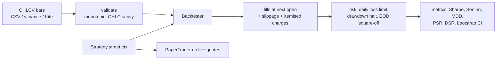

# NSE QuantLab

An event-driven backtester, ML research toolkit, and paper-trading engine for Indian equities, built around one question: **is this backtest lying to me?**


Most retail backtests look great and lose money live, for three reasons: they leak future information, they report the best of many tries as if it were the only try, and they ignore costs. This project makes each of those mistakes measurable.

## Three experiments

`python scripts/research_demo.py` runs all three on synthetic random-walk prices. A random walk has **no predictable signal by construction**, so any edge a method finds is an artefact.

### 1. Look-ahead in ML evaluation

A gradient-boosted classifier predicts next-day direction from 16 technical features, evaluated two ways on 2,000 days:

| Evaluation | Direction accuracy | Backtest Sharpe | P(Sharpe > 0) |
|---|---|---|---|
| In-sample (fit and predict on the same rows) | 0.782 | **4.52** | 1.000 |
| Purged walk-forward | 0.493 | **−0.86** | 0.020 |

The in-sample model "discovers" a Sharpe-4.5 strategy in pure noise. Walk-forward validation with purging and an embargo (López de Prado, ch. 7) correctly reports a coin flip.

### 2. Selection bias from parameter sweeps

Sweep 30 SMA-crossover parameter pairs and keep the best:

| Best params | Annualised Sharpe | Probabilistic Sharpe (vs 0) | Deflated Sharpe (vs best-of-30 luck) |
|---|---|---|---|
| 30 / 150 | 1.08 | 0.996 | **0.884** |

On its own the winner looks 99.6 % likely to be real. The [Deflated Sharpe Ratio](https://www.davidhbailey.com/dhbpapers/deflated-sharpe.pdf) asks how high a Sharpe the best of 30 *unskilled* trials would reach, and drops the confidence below the conventional 95 % bar. The deflation is modest here because the 30 SMA variants are highly correlated; with genuinely different strategies it bites harder.

### 3. What Indian transaction costs do to intraday strategies

A 5-minute z-score mean-reversion strategy over one year:

| Costs | Trades | Charges (% of capital) | Net Sharpe | Total return |
|---|---|---|---|---|
| None | 8,329 | 0.0 % | 0.27 | +3.3 % |
| Zerodha MIS + 2 bps slippage | 7,408 | 37.8 % | −6.67 | **−74.0 %** |

A ₹1 lakh intraday round trip costs ₹82.68 in statutory charges and brokerage (8.27 bps) before slippage, so a high-turnover strategy needs a large per-trade edge just to break even.

```text
$ quantlab charges 100000 --product intraday
 buy: brokerage ₹20.00, stt ₹0.00, exchange ₹3.07, sebi ₹0.10, stamp ₹3.00, gst ₹4.17, dp ₹0.00  | total ₹30.34
sell: brokerage ₹20.00, stt ₹25.00, exchange ₹3.07, sebi ₹0.10, stamp ₹0.00, gst ₹4.17, dp ₹0.00  | total ₹52.34
round trip: 8.27 bps of traded value
```

## Design



**No look-ahead by construction.** At the close of bar *t* the strategy receives a `Context` whose `history` ends at bar *t*. Its order fills at the open of bar *t+1*. A test asserts the strategy never sees a row beyond *t*, and another rewrites the future to prove features at *t* do not change.

| Module | What it does |
|---|---|
| `costs.py` | Itemised brokerage, STT, NSE transaction charge, SEBI fee, stamp duty, GST and DP charges for MIS and CNC, matching Zerodha's [published rates](https://zerodha.com/charges) (Nov 2026); every rate is overridable |
| `engine.py` | Bar-by-bar backtester: next-open fills, cash guard on gap-ups, CNC long-only, MIS square-off, daily loss limit, drawdown kill switch |
| `features.py` | 16 point-in-time features (multi-horizon returns, volatility regime, RSI, SMA gaps, gap, volume z-score) |
| `validation.py` | Purged, embargoed walk-forward splitter and out-of-sample prediction |
| `metrics.py` | CAGR, Sharpe, Sortino, max drawdown, Calmar, Probabilistic and Deflated Sharpe, block-bootstrap Sharpe CI |
| `live.py` | `PaperBroker` (simulated fills with real charges), tick-to-candle builder, `PaperTrader` with 15:15 square-off and daily loss limit, read-only Kite LTP feed |

## Usage

```bash
pip install -e ".[data]"

# Real NSE data via Yahoo Finance
quantlab backtest --symbol RELIANCE.NS --strategy sma --fast 20 --slow 100 --product delivery
quantlab backtest --csv my_5min_bars.csv --strategy meanrev --product intraday
```

```python
from quantlab import Backtester, BacktestConfig, PurgedWalkForward, SignalStrategy, walk_forward_predict
from quantlab.data import fetch_yahoo
from quantlab.features import make_features, make_labels
from sklearn.ensemble import GradientBoostingClassifier

bars = fetch_yahoo("INFY.NS", start="2015-01-01")
p_up = walk_forward_predict(lambda: GradientBoostingClassifier(), make_features(bars), make_labels(bars),
                            PurgedWalkForward(train_size=750, test_size=60, embargo=5))
result = Backtester(BacktestConfig(product="delivery")).run(bars.loc[p_up.index[0]:], SignalStrategy(p_up))
print(result.summary())
```

### Paper trading

```python
from quantlab import PaperBroker, PaperTrader, IndianEquityCosts, ZScoreMeanReversion
from quantlab.live import kite_ltp_quote

broker = PaperBroker(cash=1_000_000, costs=IndianEquityCosts("intraday"))
trader = PaperTrader("RELIANCE", ZScoreMeanReversion(window=12), broker, candle_minutes=5)
trader.run(kite_ltp_quote(API_KEY, ACCESS_TOKEN, "NSE:RELIANCE"))  # never sends a real order
```

Live order routing is intentionally not implemented. Before connecting any strategy to real money, read SEBI's framework for retail algorithmic trading and your broker's API terms, and paper-trade long enough to see how live fills differ from the backtest.

## Development

```bash
pip install -e ".[dev]"
pytest                          # 27 tests, ~1 s
ruff check src tests scripts
python scripts/research_demo.py # ~35 s
```

## Limitations

- Single-instrument backtests; portfolio construction across symbols is the next step.
- Fills assume the next open is achievable at `open ± slippage`; there is no order-book or volume-participation model.
- Yahoo data is adjusted daily data with gaps; use broker historical data for intraday research.
- Corporate actions are only handled to the extent the data source adjusts for them.

## License

MIT. Nothing here is investment advice.
